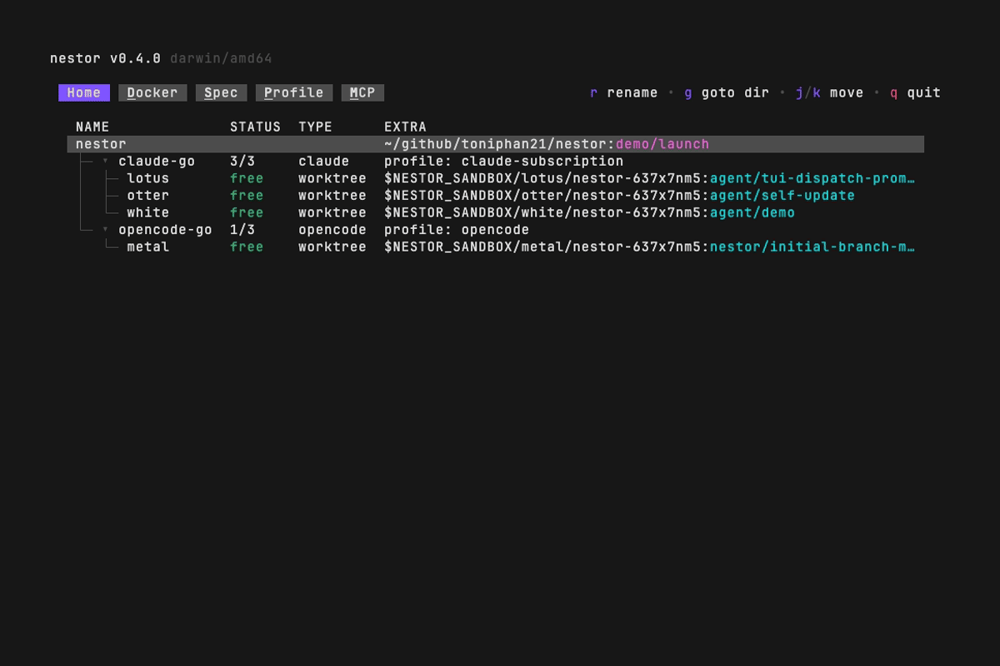

# nestor

nestor runs `Claude Code` or `OpenCode` inside sandboxed containers, driven by a built-in TUI
or as a Go library.

- Credentials and MCP secrets stay on the host; two proxies inject them on the way out, so the
  agent never sees them.
- Each sandbox runs on a git worktree, giving the agent an isolated copy of your project.
- The built-in TUI lets you browse sandboxes and launch or prompt a harness in seconds.



## Use as standalone binary

### Installation

```bash
curl -sSfL https://github.com/toniphan21/nestor/releases/latest/download/install.sh | sh
```

Installs `nestor` into `~/.local/bin`. Make sure that's on your `PATH`. Once installed, run
`nestor self-update` any time to pull the latest release.

#### Manual install

```bash
# macOS arm64 (Apple Silicon); use nestor_darwin_amd64 on Intel
curl -sSfL https://github.com/toniphan21/nestor/releases/latest/download/nestor_darwin_arm64.tar.gz \
  | tar -xz nestor
install -m 755 nestor ~/.local/bin/nestor
```

```bash
# Linux amd64; use nestor_linux_arm64 on arm
curl -sSfL https://github.com/toniphan21/nestor/releases/latest/download/nestor_linux_amd64.tar.gz \
  | tar -xz nestor
install -m 755 nestor ~/.local/bin/nestor
```

### Quick Usage

```bash
nestor
```

Running `nestor` with no arguments opens the TUI, which checks your setup and flags any
problems or missing configuration — profiles, MCP servers, sandbox specs — so you know
exactly what to fix before you launch.

## Use as library

nestor can be imported and used as a library to build your own agent orchestrator.

## Contributing & License

PRs are welcome! See [CONTRIBUTING](CONTRIBUTING.md). Distributed under the Apache License 2.0.
